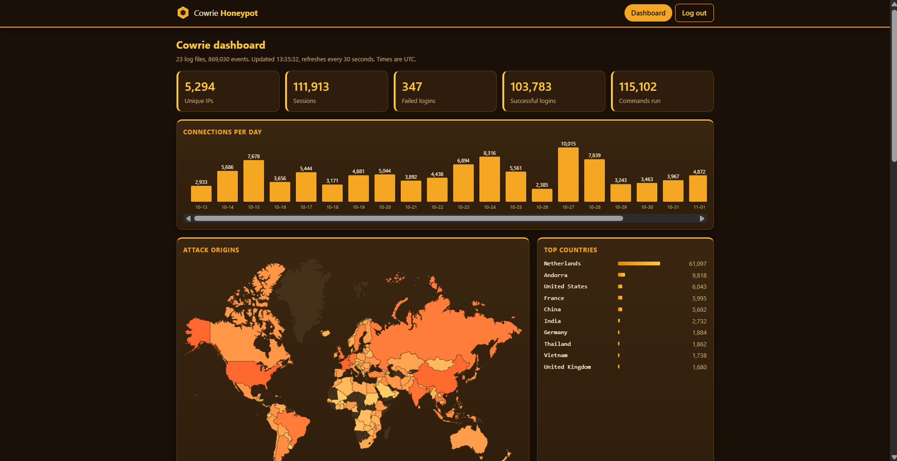

# Cowrie Hive

A login-protected, honey-themed web dashboard for [Cowrie](https://github.com/cowrie/cowrie) SSH/Telnet honeypot logs. It parses Cowrie's JSON logs, shows who is attacking and what they try, and maps attack origins by country.



## Features

- **Attack overview:** unique IPs, sessions, failed and successful logins, commands run, connections per day
- **Top usernames, passwords and commands** attempted by attackers
- **Source IP table:** sortable, filterable, click an IP to filter the live feed, one-click IP list copy
- **Attack origins map:** countries shaded by session count, using a local GeoIP database (no third-party API calls)
- **Live feed** of recent commands and file downloads
- **Authentication:** local username/password and optional Google sign-in restricted to an allowlist
- **Honey-themed UI**, self-hosted assets only (works under a strict Content Security Policy)

## Architecture

```
Browser --HTTPS--> nginx (TLS, rate limits) --127.0.0.1:8080--> gunicorn --> Flask (app.py)
                                                                              |
        /var/lib/cowrie-dashboard/  (users.db, GeoIP .mmdb)  <----------------+
        Cowrie JSON logs  <---- cowrie_data.py (parse, merge, cache) <--------+
```

| Piece | Role |
|---|---|
| `app.py` | Routes, login, sessions, security headers |
| `cowrie_data.py` | Parses Cowrie logs (plain or `.gz`), merges them, looks up countries, caches for 15 s |
| `templates/` | `base.html` (navbar), `login.html`, `signup.html`, `index.html` |
| `static/` | CSS, `dashboard.js` (fetches `/api/data` every 30 s), map and icons |
| `deploy/` | Example nginx and systemd configs |

## Security design

| Control | How it works |
|---|---|
| Deny by default | A `before_request` hook requires a session for every route not on a short public list |
| Passwords | Salted hashes (Werkzeug), 12-character minimum, a dummy hash check so timing doesn't reveal valid usernames |
| Sessions | Signed cookie: `HttpOnly`, `Secure`, `SameSite=Lax`, 8-hour lifetime, cleared on login to prevent fixation |
| CSRF | Flask-WTF tokens on every form; logout is a POST |
| Rate limiting | Flask-Limiter on login (5/min, 30/h) plus nginx `limit_req` on `/login` |
| Google sign-in | Authlib OIDC (state and nonce checked); only **verified** emails on `GOOGLE_ALLOWED_EMAILS` may enter; the app refuses to start if Google is enabled without an allowlist |
| Proxy trust | `ProxyFix` trusts exactly one hop; nginx overwrites `X-Forwarded-For`; gunicorn listens on loopback only |
| Hostile data | Attackers control usernames, passwords and commands shown in the feed: everything is escaped, never rendered as links, and CSP is `default-src 'self'` |
| Privacy | IP-to-country lookups use a local database, so attacker IPs are never sent to a third party |
| File permissions | Code is root-owned `644`; data lives outside the web root in a `700` folder; the env file is `600` |

## Setup

Tested on Ubuntu 24.04, Python 3.12, nginx 1.24.

1. **Prerequisite:** a running Cowrie that writes `cowrie.json` logs.
2. **Install the app**
   ```bash
   sudo mkdir -p /opt/cowrie-dashboard && sudo cp -r . /opt/cowrie-dashboard
   cd /opt/cowrie-dashboard
   sudo python3 -m venv venv && sudo venv/bin/pip install -r requirements.txt
   ```
3. **Configure:** copy `.env.example` to `/etc/cowrie-dashboard.env`, fill it in, then `sudo chown root:root` and `sudo chmod 600` it.
4. **Data folder and first user**
   ```bash
   sudo mkdir -p /var/lib/cowrie-dashboard
   sudo chown <service-user>: /var/lib/cowrie-dashboard && sudo chmod 700 /var/lib/cowrie-dashboard
   sudo bash -c 'set -a; . /etc/cowrie-dashboard.env; set +a; cd /opt/cowrie-dashboard && ./venv/bin/flask --app app create-user admin'
   sudo chown <service-user>: /var/lib/cowrie-dashboard/users.db && sudo chmod 600 /var/lib/cowrie-dashboard/users.db
   ```
5. **GeoIP database (optional):** download the free *IP to Country Lite* file from [DB-IP](https://db-ip.com/db/download/ip-to-country-lite), unpack it to the path in `GEOIP_DB`, and restart the service whenever you update it.
6. **Permissions:** app files `root:root` `644`, folders `755`.
   ```bash
   sudo chown -R root:root /opt/cowrie-dashboard/{app.py,cowrie_data.py,static,templates}
   sudo chmod 644 /opt/cowrie-dashboard/{app.py,cowrie_data.py}
   sudo find /opt/cowrie-dashboard/static /opt/cowrie-dashboard/templates -type f -exec chmod 644 {} +
   sudo find /opt/cowrie-dashboard/static /opt/cowrie-dashboard/templates -type d -exec chmod 755 {} +
   ```
7. **Service and proxy:** adapt `deploy/cowrie-dashboard.service` and `deploy/nginx.conf.example`, get a certificate with certbot, then:
   ```bash
   sudo systemctl daemon-reload && sudo systemctl enable --now cowrie-dashboard
   sudo nginx -t && sudo systemctl reload nginx
   ```
8. **Verify:** `curl -I https://YOUR_DOMAIN/` should return `302` to `/login`, and `/api/data` without a session must return `401`.

### Configuration

| Variable | Required | Purpose |
|---|---|---|
| `FLASK_SECRET_KEY` | Yes | Signs session cookies and CSRF tokens; rotate it to log everyone out |
| `DATABASE` | No | Path of the user database |
| `COOKIE_SECURE` | No | `1` (default) needs HTTPS; use `0` only for local testing |
| `COWRIE_LOG_DIR` | No | Where Cowrie writes its JSON logs |
| `GEOIP_DB` | No | Country database; the map stays empty without it |
| `SIGNUP_CODE` | No | Enables the invite-only `/signup` page when set |
| `GOOGLE_CLIENT_ID`, `GOOGLE_CLIENT_SECRET` | No | Enable Google sign-in |
| `GOOGLE_ALLOWED_EMAILS` | If Google is on | Comma-separated verified emails allowed to log in |
| `GOOGLE_REDIRECT_URI` | No | Pins the OAuth callback URL |

## Findings

| Item | Result |
|---|---|
| Observation period | 23 days |
| Total sessions / unique IPs | 111,913 / 5,294 |
| Top username | root |
| Top password | 123456 |
| Top country (hosting location) | Netherlands |
| Most interesting command | uname -svnrm |

## Limitations

- **Sessions can't be revoked individually.** They live in a signed cookie, so rotating the secret key is the only emergency logout.
- **Rate limits are per process** (in-memory), which is why the service runs one worker.
- **Country data shows where machines are hosted,** not where attackers are. Honeypot traffic is mostly VPSs, botnets and proxies.
- **The Google allowlist is read at startup,** so changing it needs a restart.
- **SQLite user store:** fine for one admin or a few people, not for many users.
- **Certificate renewal** is not automated in the reference setup (see the nginx example).

## What I learned

- Google proving *who* someone is does not decide *whether* they may enter: my first version accepted any Google account until I added an allowlist.
- Passing a proxy header through unchanged lets clients spoof their IP; nginx must overwrite it.
- Permission problems (a service user that cannot read files or write its database folder) caused most of the deployment errors.
- A single merged nginx `server` block silently broke port 80 and certificate validation.

## Credits and licenses

- [Cowrie](https://github.com/cowrie/cowrie) honeypot (BSD-3-Clause). This project is not affiliated with it.
- IP geolocation by [DB-IP](https://db-ip.com) (IP to Country Lite, CC BY 4.0).
- World map shapes from [@svg-maps/world](https://www.npmjs.com/package/@svg-maps/world) ([CC BY 4.0](https://creativecommons.org/licenses/by/4.0/)), modified: coordinates rounded and country IDs uppercased.
- Built with Flask, Flask-WTF, Flask-Limiter, Authlib, gunicorn and maxminddb.
- This project's code is released under the [MIT License](LICENSE).

## Responsible use

Run honeypots on an isolated host, never reuse real credentials on it, and check your provider's terms and local law before exposing one.
